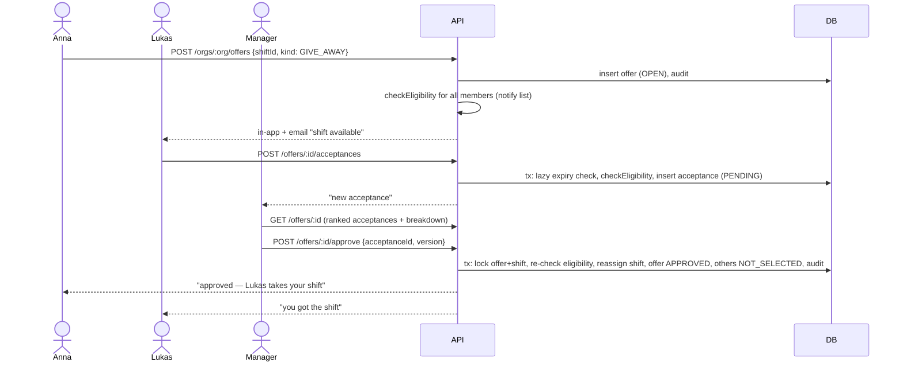
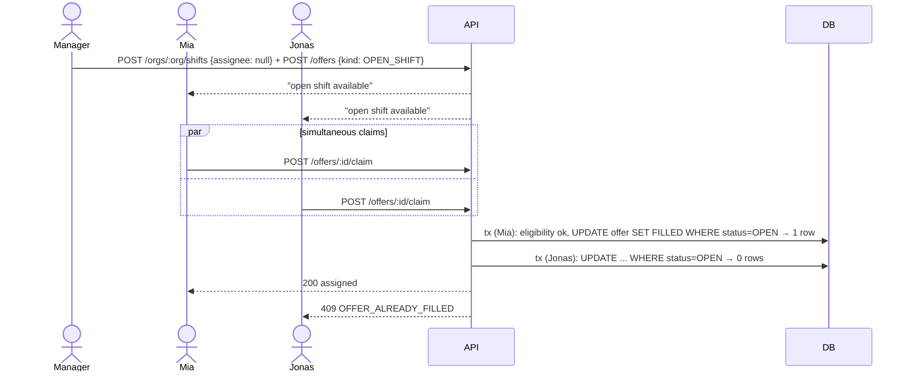
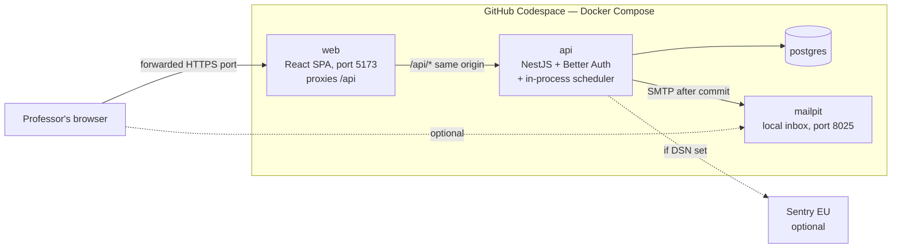
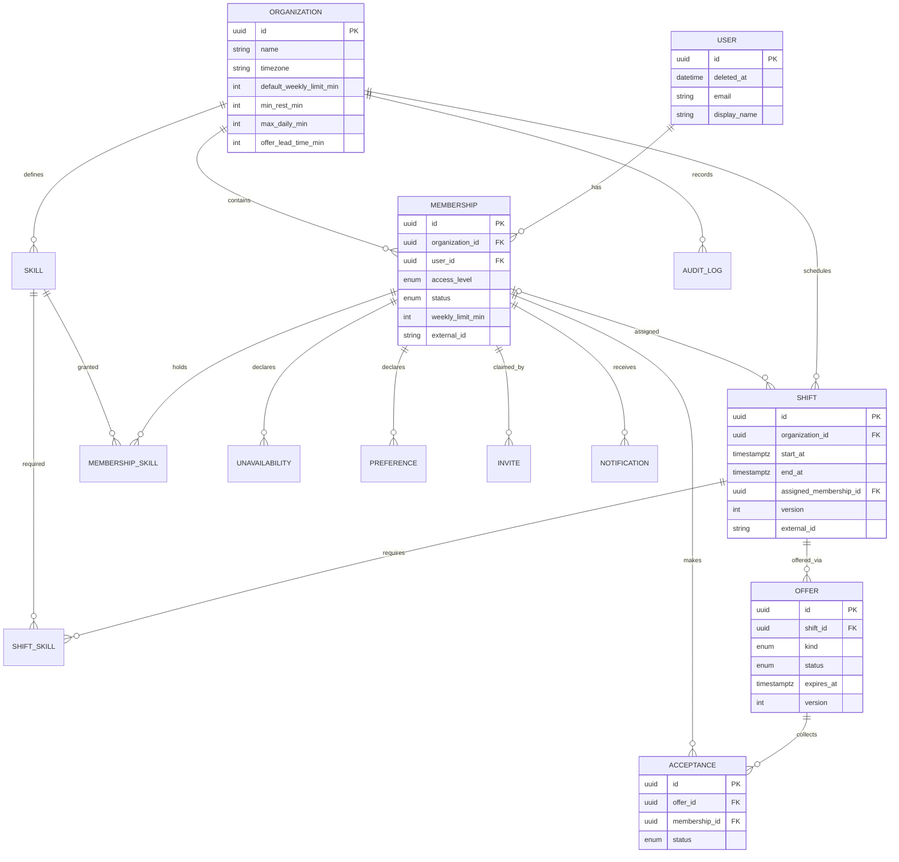
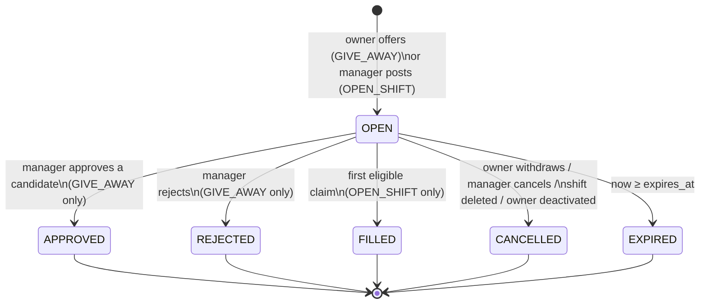
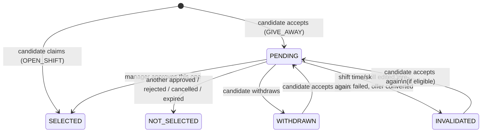
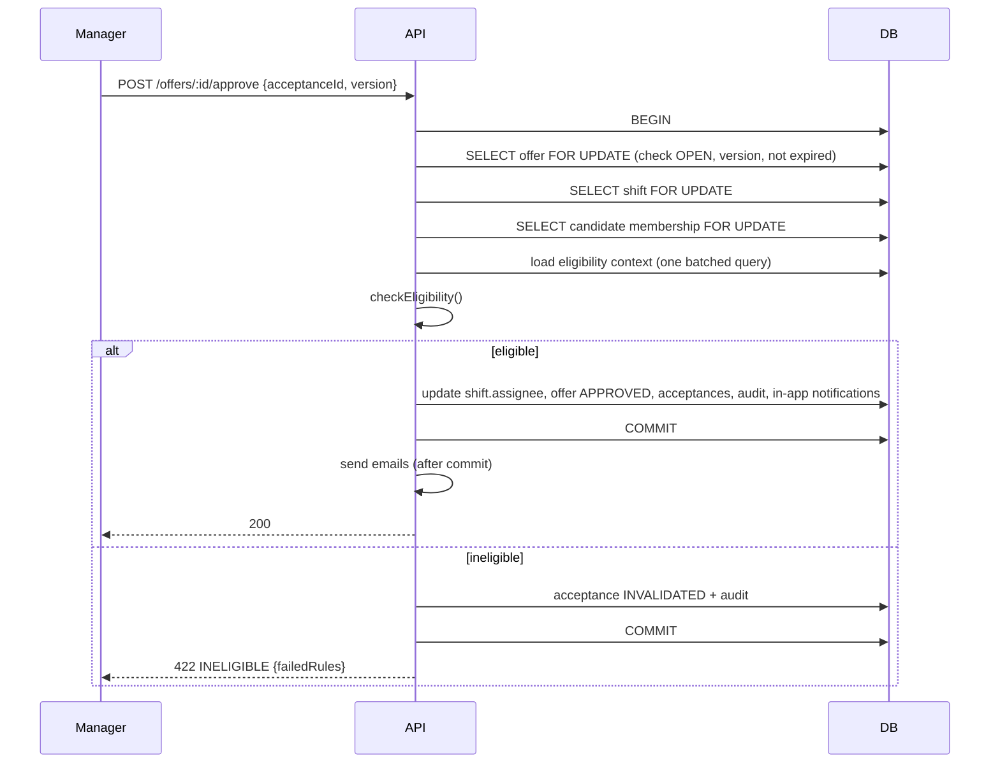
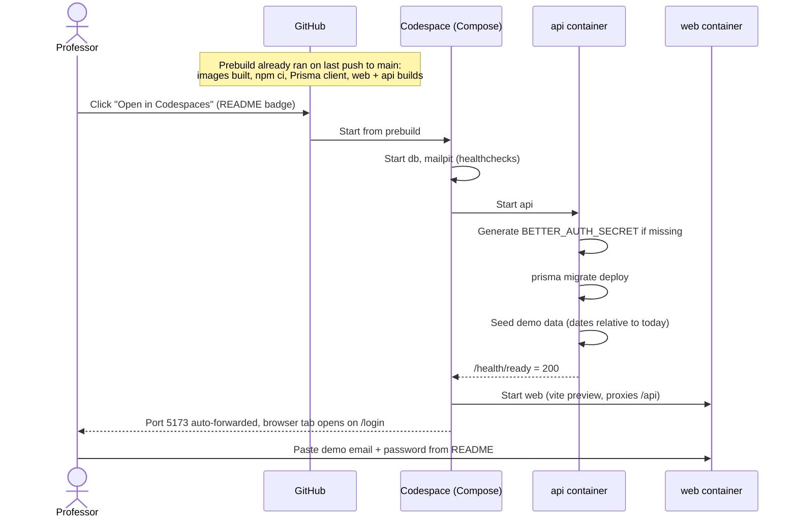

# ShiftSwap — Software Design Document

Oct 23, 2026 · @Bash

## 1. Executive Summary

ShiftSwap is a multi-tenant B2B web app that replaces WhatsApp-style shift swapping with a validated, auditable workflow for small shift-based businesses (restaurants, cafés, hotels, retail).

An employee offers a shift. ShiftSwap filters coworkers by hard rules (skills, overlaps, unavailability, company hour policies), notifies the eligible ones, ranks those who accept with an explainable score, and lets a manager approve. Managers can also post unassigned open shifts that the first eligible employee claims. Every change lands in an audit log.

ShiftSwap is the source of truth for the schedule in the MVP, but stores `external_id` / `source` on members and shifts so HR or scheduling integrations can be added later.

Architecture: React SPA + NestJS modular monolith + PostgreSQL, with email/password auth via the Better Auth library stored in ShiftSwap's own database. The system runs in **GitHub Codespaces**: opening a Codespace builds, migrates, seeds demo data and opens the app in the browser automatically, so the professor only types a demo email and password from the README. GitHub Actions runs CI on every PR.

The core technical showcase is the eligibility + ranking engine and the concurrency-safe offer workflow.

## 2. Product Scope

ShiftSwap is a lightweight scheduling layer plus a shift-offer workflow. It owns the schedule for the MVP; it is not an HR, payroll or workforce-management suite.

**In scope**

- Organisation workspaces with members, skills and company hour policies
- Manual single-shift scheduling (create / edit / delete), no recurrence
- CSV import of members and shifts; CSV export of shifts
- **Shift offers**, one mechanism with two kinds:
  - *Give-away*: an employee offers their shift; several coworkers accept; a manager picks one and approves
  - *Open shift*: a manager posts an unassigned shift; the first eligible claimant gets it immediately
- Eligibility filtering (hard rules) and explainable ranking (soft score)
- One-off unavailability and a weekly preference grid
- In-app + email notifications
- Audit log

**Source of truth:** ShiftSwap's database is authoritative for shift assignments. CSV is a one-way load/update path, never a sync.

## 3. Goals

1. Replace informal swap chats with one structured, validated flow from offer to approved assignment.
2. Never assign a shift to someone who is double-booked, unqualified, unavailable, or over a company hour limit at the moment of approval.
3. Make the original owner's responsibility explicit: they stay assigned until a manager approves.
4. Give managers a ranked, explained shortlist instead of a gut decision.
5. Isolate each company's data completely from every other company.
6. Demonstrate a credible engineering process: REST API, relational DB, Docker, three environments, CI/CD, tests on the core workflow, WCAG 2.2 AA on core flows.
7. Deliver a reliable live demo of both offer kinds end to end.

## 4. Non-Goals

- Legal labour-law compliance (e.g. German ArbZG). Hour rules are **company policies**, not a compliance guarantee.
- Shift trades (A and B exchange shifts).
- Recurring shifts, templates, auto-scheduling or schedule optimisation.
- Payroll, time tracking, leave/vacation, absence reasons.
- Chat or messaging.
- Push, SMS or WhatsApp notifications.
- Live HR/scheduling-system integrations.
- Cross-organisation conflict detection for people working at several employers.
- Billing, subscriptions, platform-admin tooling.
- Native mobile apps.

## 5. Actors and Permissions

Three access levels per membership, additive: Admin ⊇ Manager ⊇ Employee. Scope is the whole organisation. One user can hold memberships in several organisations with different access levels. There is no platform admin; the team operates the system via DB access and seed scripts.

| Actor | Description |
| --- | --- |
| Employee | Works shifts, offers own shifts, accepts/claims offers, maintains own availability |
| Manager | Employee rights + schedules shifts, posts open shifts, approves/rejects give-aways, manages members, imports |
| Admin | Manager rights + org settings, policies, skills catalogue, access-level changes, org deletion |
| Placeholder member | A membership without a login (no email or not yet joined). Can hold shifts. Never notified, never a candidate |
| Scheduler (system) | In-process job: expiry notifications, retention purge |

**Permission matrix** (✓ = allowed, own = only own records, — = denied)

| Capability | Employee | Manager | Admin |
| --- | --- | --- | --- |
| View own shifts, offers, notifications | ✓ | ✓ | ✓ |
| View full team schedule | — | ✓ | ✓ |
| View eligible open offers | ✓ | ✓ | ✓ |
| Create give-away offer | own | own | own |
| Withdraw / cancel give-away offer | own | ✓ | ✓ |
| Accept give-away / claim open shift | ✓ | ✓ | ✓ |
| Withdraw own acceptance | own | own | own |
| Approve / reject give-away | — | ✓ (not own, unless sole approver) | ✓ (not own, unless sole approver) |
| Create / edit / delete shifts | — | ✓ | ✓ |
| Post / cancel open shift | — | ✓ | ✓ |
| Manage own unavailability & preferences | own | own | own |
| Invite members, create placeholders | — | ✓ | ✓ |
| Edit member skills, weekly limit, deactivate | — | ✓ | ✓ |
| Change access levels | — | — | ✓ |
| CSV import / export | — | ✓ | ✓ |
| View audit log | — | ✓ | ✓ |
| Org settings, policies, skills catalogue, lead time | — | — | ✓ |
| Delete organisation | — | — | ✓ |
| Delete own account | ✓ | ✓ | ✓ |

**Self-approval rule:** a manager/admin cannot approve their own give-away unless they are the org's only active manager/admin. Self-approvals are flagged `self_approved = true` in the audit log.

**Last-admin rule:** the last active Admin cannot be demoted or deactivated.

## 6. Functional Requirements

IDs are referenced by tests and tickets. Priority uses MoSCoW (see §36).

| ID | Requirement | Priority |
| --- | --- | --- |
| FR-01 | Anyone can sign up and create an organisation; the creator becomes Admin | Must |
| FR-02 | Manager/Admin invites a member by email; single-use link, valid 7 days | Must |
| FR-03 | Manager/Admin creates placeholder members (no login); an invite can later claim the placeholder | Must |
| FR-04 | A user with memberships in several orgs switches org via an org switcher | Must |
| FR-05 | Admin maintains a skills catalogue; members and shifts reference 0..n skills | Must |
| FR-06 | Manager sets each member's weekly hour limit (falls back to org default) | Must |
| FR-07 | Manager creates, edits, deletes single shifts; week-view grid | Must |
| FR-08 | Employee creates a give-away offer for an own future shift | Must |
| FR-09 | Eligible employees see open offers and accept (give-away) or claim (open shift) | Must |
| FR-10 | Manager sees ranked acceptances with per-factor score breakdown and re-check result; selects one and approves, or rejects the offer | Must |
| FR-11 | Manager posts an open shift; first eligible claimant is assigned immediately | Must |
| FR-12 | Eligibility is re-checked transactionally at accept/claim and at approval | Must |
| FR-13 | Offers expire at `shift.start − org.offer_lead_time` (default 2 h) | Must |
| FR-14 | Editing a shift's time or skills invalidates pending acceptances; deleting it cancels the offer | Must |
| FR-15 | Deactivating a member converts their open give-aways to open shifts and unassigns their future shifts | Must |
| FR-16 | Employee records one-off unavailability periods (hard block) | Must |
| FR-17 | In-app notifications for the events in §23 | Must |
| FR-18 | Every state change is written to an append-only audit log; managers can list it | Must |
| FR-19 | Employee maintains a 7×3 weekly preference grid (preferred / neutral / avoid) | Should |
| FR-20 | Email notifications for the events in §23 | Should |
| FR-21 | CSV import of members with dry-run preview, all-or-nothing | Should |
| FR-22 | CSV import of shifts with dry-run preview, all-or-nothing; CSV export of shifts by date range | Should |
| FR-23 | User deletes own account (anonymisation) | Should |
| FR-24 | Retention purge jobs | Should |
| FR-25 | Employee withdraws own acceptance; owner withdraws own offer | Must |

**Open question on FR-15:** the grilling agreed on converting open give-aways. Unassigning the deactivated member's *other* future shifts (without offers) is derived, not agreed — see §40.

## 7. Non-Functional Requirements

| ID | Category | Requirement |
| --- | --- | --- |
| NFR-01 | Performance | API p95 < 300 ms for reads at MVP scale (§34) |
| NFR-02 | Performance | Eligibility + ranking for one offer < 200 ms (≤ 100 members) |
| NFR-03 | Performance | Employee screens LCP < 2.5 s on mid-range 4G mobile |
| NFR-04 | Consistency | No double assignment and no double claim under concurrent requests |
| NFR-05 | Security | No cross-tenant data access; verified by automated tests on every org-scoped endpoint |
| NFR-06 | Accessibility | WCAG 2.2 AA on core flows; axe: zero serious/critical; Lighthouse a11y ≥ 90 on employee screens |
| NFR-07 | Usability | Employee flows mobile-first; manager flows desktop-first but usable on phones |
| NFR-08 | Privacy | Minimal personal data; no health data; anonymisation on account deletion; retention per §27 |
| NFR-09 | Operability | Health endpoints, structured logs without PII, Sentry error tracking when a DSN is configured |
| NFR-10 | Delivery | Every PR runs CI; `main` always starts cleanly in a fresh Codespace |
| NFR-11 | **Zero-setup demo** | Opening a Codespace on `main` starts every service, applies migrations, seeds demo data and opens the app in the browser. No terminal command, no secret, no config is required from the user |
| NFR-12 | **Fast start** | App usable ≤ 90 s after the Codespace opens, using Codespaces prebuilds (proposal target, §40) |
| NFR-13 | **Self-contained** | No external service is required to run the app; email goes to a local inbox (Mailpit), Sentry is optional |

## 8. User Flows

Two flows carry the demo: the give-away (manager picks among acceptances) and the open shift (first eligible claimant wins).

**Flow A — Give-away (Anna → Lukas)**



**Flow B — Open shift claim**



**Supporting flows** (screens in §12): org signup → invite members / import CSV → define skills and policies → create shifts; employee: accept invite → set unavailability and preferences → view shifts.

## 9. Domain Glossary

| Term | Meaning in ShiftSwap |
| --- | --- |
| Organisation (org) | One customer company; the tenant boundary |
| User | A login identity (email + password, managed by Better Auth). Can belong to several orgs |
| Membership | A user's (or placeholder's) role inside one org: access level, skills, weekly limit, status |
| Access level | Permission tier: EMPLOYEE, MANAGER, ADMIN |
| Skill | A job position or qualification required by a shift (e.g. Bartender, Food hygiene cert). Replaces "role" + "qualification" |
| Shift | One block of work with start/end, required skills, optional assignee |
| Offer | A request for a shift to get a new owner. Kinds: GIVE\_AWAY, OPEN\_SHIFT |
| Acceptance | One candidate's "I'll take it" on a give-away offer |
| Claim | Taking an open shift; succeeds or fails immediately |
| Eligibility | Pass/fail result of the hard rules for (member, shift) |
| Score | 0–100 ranking of eligible acceptances; soft |
| Policy | Org-level hour rule (weekly max, min rest, daily max) |
| Lead time | Hours before shift start at which an open offer expires |
| Placeholder | Membership without a login |
| Tenant | Synonym for organisation in technical sections |

## 10. System Architecture Overview

One React single-page app talks to one NestJS modular monolith over REST; the monolith owns one PostgreSQL database, including the auth tables. Everything runs as Docker Compose services inside a GitHub Codespace; the browser reaches the app through one forwarded port.



Key properties:

- **Single deployable backend** — no microservices, no message broker, no cache.
- **Same origin:** the SPA's dev/preview server proxies `/api` to the backend, so session cookies work and no CORS or dynamic Codespace URL config is needed.
- **Synchronous request/response** for all user actions; the only background work is the 5-minute in-process scheduler.
- **Email is fire-and-forget after commit** to Mailpit; in-app notifications are written in the same transaction as the business change.
- **No external dependency is required to run.**

## 11. Technology Stack

| Layer | Choice | Why |
| --- | --- | --- |
| Language | TypeScript (frontend + backend) | One language; shared types and Zod schemas |
| Repo | Monorepo: `apps/web`, `apps/api`, `packages/shared` (npm/pnpm workspaces) | Shared validation schemas and types |
| Frontend | React + Vite | Fast dev loop; SPA is enough behind a login (no SEO) |
| Routing | React Router | Org-scoped URLs |
| Server state | TanStack Query | Caching, refetch on focus, invalidation after mutations |
| UI | shadcn/ui on Radix + Tailwind | Accessible primitives |
| Forms | React Hook Form + Zod | Same schemas as backend |
| Backend | NestJS | Modules, guards, DI fit a modular monolith |
| ORM | Prisma (+ raw SQL for row locks) | Typed queries, migrations |
| Database | PostgreSQL | Relational domain, transactions, row locks |
| Auth | Better Auth (email + password, Prisma adapter) | Library-managed hashing and sessions in our DB; seedable demo users; no external service or secrets |
| Email | Mailpit (local SMTP + web inbox) | Invites and notifications visible in the demo without a provider |
| Logging | nestjs-pino (JSON) | Structured logs |
| Errors | Sentry (EU region), optional via DSN | Crash reports when configured |
| Tests | Vitest/Jest, Supertest, Testing Library, Playwright, axe-core | See §32 |
| Containers | Docker, Docker Compose, Dev Container spec | Same stack in Codespaces, CI and laptops |
| Hosting | GitHub Codespaces (+ prebuilds) | Zero-setup demo for the professor |
| CI | GitHub Actions | PR checks, prebuild trigger |

## 12. Frontend Architecture

Ten screens, mobile-first for employees, desktop-first for managers. Server data lives only in TanStack Query; no Redux/Zustand.

| # | Screen | Route | Audience |
| --- | --- | --- | --- |
| 1 | My Shifts | `/orgs/:orgId/me/shifts` | Employee |
| 2 | Open Offers | `/orgs/:orgId/offers` | Employee |
| 3 | Availability | `/orgs/:orgId/me/availability` | Employee |
| 4 | Notifications | `/orgs/:orgId/notifications` (or header dropdown) | All |
| 5 | Schedule (week grid) | `/orgs/:orgId/schedule?week=2026-W44` | Manager+ |
| 6 | Offer Review | `/orgs/:orgId/review` | Manager+ |
| 7 | Members | `/orgs/:orgId/members` | Manager+ |
| 8 | Import / Export | `/orgs/:orgId/import` | Manager+ |
| 9 | Org Settings | `/orgs/:orgId/settings` | Admin |
| 10 | Audit Log | `/orgs/:orgId/audit` | Manager+ |
| — | Sign-in / sign-up | `/login` (own form, Better Auth) | Public |
| — | Invite acceptance | `/invites/:token` | Public → auth |
| — | Org picker / create org | `/orgs` | Authenticated |

**Structure**

- `features/<area>/` per screen group: components, hooks (`useShifts`, `useAcceptOffer`), API calls.
- `api/client.ts`: fetch wrapper that sends the session cookie (`credentials: 'include'`) and maps error codes (§24) to UI messages.
- Route guard component hides manager/admin routes; the backend still enforces every permission.
- Org switcher in the header; current org = URL param, never global state.

**Stale data handling**

- Refetch on window focus; invalidate affected queries after each mutation.
- Mutations send `version`; a `409 VERSION_CONFLICT` shows "Changed by someone else — reload" and refetches.
- No optimistic UI for accept/claim/approve: the button shows a pending state until the server answers.

**Schedule grid:** members × days table, click a cell or shift to open an edit dialog. No drag-and-drop.

## 13. Backend Architecture

A NestJS modular monolith: one process, one database, modules with explicit public services. Modules call each other's services, never each other's tables.

| Module | Responsibility |
| --- | --- |
| `auth` | Mount Better Auth handler at `/api/auth/*`; `SessionGuard` resolves the session cookie to a `User` |
| `tenancy` | `OrgGuard`: resolve `:orgId`, load membership, enforce access level, attach `OrgContext` |
| `organizations` | Org signup, settings, policies, deletion |
| `memberships` | Members, placeholders, invites, skills assignment, deactivation |
| `skills` | Skills catalogue |
| `shifts` | Shift CRUD, week queries, optimistic locking, edit side-effects on offers |
| `availability` | Unavailability periods, preference grid |
| `matching` | **Pure** `checkEligibility()` and `scoreCandidate()` — no DB, no Nest dependencies |
| `offers` | Offer + acceptance workflow, state machine, transactions, locking |
| `notifications` | In-app rows (in tx) + email dispatch to SMTP/Mailpit (after commit) |
| `audit` | Append-only writer + list query |
| `imports` | CSV parse, validate, preview, apply; export |
| `scheduler` | 5-min interval: expire offers + notify; nightly: retention purge |
| `health` | `/health/live`, `/health/ready` |
| `seed` | Idempotent demo-data loader run on container start (§29) |

**Request pipeline:** Session guard (Better Auth cookie) → OrgGuard (membership + access level) → Zod validation pipe → controller → service (opens transaction) → Prisma → audit + in-app notification in same tx → commit → email dispatch.

**Matching boundary:** `offers` loads one *eligibility context* per check with a single batched query (candidate memberships, their skills, shifts in the relevant window, unavailability, preferences, recent swap counts), then calls the pure functions. This keeps the core logic unit-testable without a database.

**State machine** lives in `offers/domain/offer-state.ts` as an explicit transition table; services call `assertTransition(from, to)`.

## 14. Database Design

PostgreSQL, one shared schema, `organization_id` on every org-owned table. All timestamps `timestamptz` stored in UTC; the org's IANA timezone (e.g. `Europe/Berlin`) is used for week boundaries, day limits and preference slots. Durations are stored in minutes.

**Schema proposal**

| Table | Key columns | Constraints / indexes |
| --- | --- | --- |
| `users` | id, email, name, email\_verified, deleted\_at (Better Auth \`user\` table, extended) | unique(lower(email)) |
| `organizations` | id, name, timezone, default\_weekly\_limit\_min, min\_rest\_min (660), max\_daily\_min (600), offer\_lead\_time\_min (120), deletion\_requested\_at | — |
| `memberships` | id, organization\_id, user\_id?, display\_name, email?, access\_level, status, weekly\_limit\_min?, external\_id?, source | unique(org, user\_id) where user\_id not null; unique(org, lower(email)); unique(org, external\_id) |
| `invites` | id, organization\_id, membership\_id, email, token\_hash, expires\_at, accepted\_at, created\_by | unique(token\_hash) |
| `skills` | id, organization\_id, name | unique(org, name) |
| `membership_skills` | membership\_id, skill\_id | PK(membership\_id, skill\_id) |
| `shifts` | id, organization\_id, start\_at, end\_at, assigned\_membership\_id?, location?, notes?, external\_id?, source, version, deleted\_at? | check(end\_at > start\_at); idx(org, start\_at); idx(assigned\_membership\_id, start\_at); unique(org, external\_id) |
| `shift_skills` | shift\_id, skill\_id | PK(shift\_id, skill\_id) |
| `unavailabilities` | id, organization\_id, membership\_id, start\_at, end\_at | idx(membership\_id, start\_at) |
| `preferences` | membership\_id, weekday (0–6), slot, value | PK(membership\_id, weekday, slot); only non-neutral rows stored |
| `offers` | id, organization\_id, shift\_id, kind, status, original\_owner\_membership\_id?, created\_by\_membership\_id, expires\_at, selected\_acceptance\_id?, resolved\_by?, resolved\_at?, cancel\_reason?, version | idx(org, status); **partial unique(shift\_id) where status = 'OPEN'** |
| `acceptances` | id, organization\_id, offer\_id, membership\_id, status, invalidated\_reason (jsonb)?, created\_at | **unique(offer\_id, membership\_id)** |
| `notifications` | id, organization\_id, recipient\_membership\_id, type, payload (jsonb), read\_at?, created\_at | idx(recipient\_membership\_id, created\_at) |
| `audit_logs` | id (bigserial), organization\_id, actor\_membership\_id?, action, entity\_type, entity\_id, before (jsonb), after (jsonb), metadata (jsonb), created\_at | idx(org, created\_at) |

**Enums:** `access_level` EMPLOYEE/MANAGER/ADMIN · `membership_status` ACTIVE/DEACTIVATED · `offer_kind` GIVE\_AWAY/OPEN\_SHIFT · `offer_status` OPEN/APPROVED/REJECTED/FILLED/CANCELLED/EXPIRED · `acceptance_status` PENDING/SELECTED/NOT\_SELECTED/WITHDRAWN/INVALIDATED · `slot` MORNING/AFTERNOON/EVENING · `pref_value` PREFERRED/AVOID.

**Design notes**

- A placeholder is a membership with `user_id = null`.
- Shifts are soft-deleted (`deleted_at`) so offers and audit entries keep a valid reference; purged by retention.
- The partial unique index guarantees at most one open offer per shift at DB level.
- `external_id` + `source` (`MANUAL`, `CSV`, later e.g. `PERSONIO`) prepare integrations without schema redesign.
- Migrations via Prisma Migrate; the partial unique index and row-lock queries are hand-written SQL in migrations/raw queries.

**Auth tables** (owned by Better Auth, generated into the Prisma schema): `session` (token, user\_id, expires\_at), `account` (user\_id, provider `credential`, password hash), `verification` (reset/verification tokens). ShiftSwap code never reads password hashes directly.

## 15. Entity Relationship Model



Every entity was challenged during design; none is optional for the Must scope except `PREFERENCE` (Should) and `INVITE` (needed by FR-02).

## 16. Core Domain Models

TypeScript shapes used by the matching and workflow code (simplified).

```ts
type AccessLevel = 'EMPLOYEE' | 'MANAGER' | 'ADMIN';

interface Shift {
  id: string; orgId: string;
  startAt: Date; endAt: Date;          // UTC; overnight allowed (end next day)
  requiredSkillIds: string[];
  assignedMembershipId: string | null; // null = unassigned / open
  version: number;
}

interface Offer {
  id: string; shiftId: string;
  kind: 'GIVE_AWAY' | 'OPEN_SHIFT';
  status: 'OPEN' | 'APPROVED' | 'REJECTED' | 'FILLED' | 'CANCELLED' | 'EXPIRED';
  originalOwnerId: string | null;      // null for OPEN_SHIFT
  expiresAt: Date;                     // shift.startAt - org.offerLeadTime
  version: number;
}

interface EligibilityContext {
  org: { timezone: string; defaultWeeklyLimitMin: number; minRestMin: number; maxDailyMin: number };
  candidate: { id: string; status: 'ACTIVE' | 'DEACTIVATED'; hasLogin: boolean;
               skillIds: string[]; weeklyLimitMin: number | null };
  candidateShifts: Shift[];            // window: shift week ± 1 day
  unavailability: { startAt: Date; endAt: Date }[];
}

interface EligibilityResult {
  eligible: boolean;
  failedRules: RuleCode[];             // e.g. ['OVERLAP', 'WEEKLY_LIMIT']
}

interface ScoreResult {
  total: number;                       // 0..100
  breakdown: { preference: number; headroom: number; swapLoad: number };
}
```

Invariants:

- A shift has at most one OPEN offer.
- A GIVE\_AWAY offer's shift stays assigned to the original owner until APPROVED.
- An acceptance exists at most once per (offer, member).
- Only ACTIVE memberships with a login can accept or claim.

## 17. Shift Swap State Machine

Two offer kinds share one status set; acceptances have their own small lifecycle. Every transition is checked against the table below and written to the audit log.

**Offer states**



| From → To | Kind | Who | Preconditions | Effects |
| --- | --- | --- | --- | --- |
| — → OPEN | GIVE\_AWAY | Shift owner | Shift assigned to caller, not deleted, `now < start − lead time`, no other OPEN offer on shift | Notify eligible members + managers |
| — → OPEN | OPEN\_SHIFT | Manager+ | Shift unassigned, same time rules | Notify eligible members |
| OPEN → APPROVED | GIVE\_AWAY | Manager+ (not owner unless sole approver) | Offer not expired; versions match; selected acceptance PENDING and passes re-check | Shift reassigned; acceptance SELECTED; others NOT\_SELECTED |
| OPEN → REJECTED | GIVE\_AWAY | Manager+ | Offer OPEN | Owner keeps shift; PENDING → NOT\_SELECTED |
| OPEN → FILLED | OPEN\_SHIFT | Any eligible member | Claimant passes eligibility; conditional update wins | Shift assigned; acceptance row created as SELECTED |
| OPEN → CANCELLED | both | Owner (own give-away), Manager+, or system | — | PENDING → NOT\_SELECTED; reason stored (`WITHDRAWN`, `MANAGER`, `SHIFT_DELETED`, `OWNER_DEACTIVATED`) |
| OPEN → EXPIRED | both | System (lazy check or scheduler) | `now ≥ expires_at` | PENDING → NOT\_SELECTED; owner + managers notified |

**Owner deactivated:** the give-away is CANCELLED (`OWNER_DEACTIVATED`), its PENDING acceptances become INVALIDATED with a "claim now" notice, the shift is unassigned, and a **new OPEN\_SHIFT offer** is created for it. Two rows instead of mutating the kind keeps each offer's history linear.

**After REJECTED / EXPIRED / CANCELLED** the owner may create a new offer for the same shift (new row).

**Acceptance states**



Re-accepting reuses the existing row (unique `(offer_id, membership_id)`).

## 18. Matching / Eligibility Algorithm

Matching is two pure functions: `checkEligibility` (hard rules, pass/fail with reasons) and `scoreCandidate` (soft 0–100 score with breakdown). Neither touches the database.

**When it runs**

| Moment | Purpose | Authoritative? |
| --- | --- | --- |
| Offer created | Decide who gets notified | No |
| Employee lists open offers | Show only offers the viewer is eligible for | No |
| Accept / claim | Reject ineligible candidate, inside the transaction | **Yes** |
| Manager approves | Final re-check of the selected candidate, inside the transaction with row lock | **Yes** |

Nothing is stored as "eligible". Scores are computed when the manager opens Offer Review.

**Hard rules** (all must pass; all failures are returned, not just the first)

| Code | Rule |
| --- | --- |
| `NOT_ACTIVE` | Membership is ACTIVE and has a login (placeholders never qualify) |
| `IS_OWNER` | Candidate is not the shift's current assignee |
| `MISSING_SKILL` | Shift's required skills ⊆ candidate's skills |
| `OVERLAP` | No assigned, non-deleted shift of the candidate overlaps `[start, end)` |
| `UNAVAILABLE` | No unavailability period overlaps the shift |
| `MIN_REST` | Gap to the candidate's previous and next shift ≥ `org.min_rest_min` (default 11 h) |
| `DAILY_LIMIT` | Minutes of shifts starting on the same org-local date, incl. this one, ≤ `org.max_daily_min` (default 10 h) |
| `WEEKLY_LIMIT` | Minutes of shifts starting in the same Mon–Sun week (org timezone), incl. this one, ≤ member limit or org default |

Offer-level checks (`OFFER_NOT_OPEN`, `OFFER_EXPIRED`) are evaluated separately before candidate rules.

Overnight shifts are allowed (`end_at` on the next local day). They count toward the day and week in which they **start**. Hour policies are **company policies, not a legal compliance engine**.

**Ranking** (only for eligible candidates)

```latex
\text{score} = P + H + S, \quad 0 \le \text{score} \le 100
```

| Factor | Formula | Range |
| --- | --- | --- |
| P — Preference | Worst value of the slots the shift touches: PREFERRED 40, neutral 20, AVOID 0 | 0–40 |
| H — Hours headroom | 40 × (1 − weekly minutes after taking shift ÷ weekly limit), rounded | 0–40 |
| S — Swap load | max(0, 20 − 5 × shifts taken via ShiftSwap in last 30 days) | 0–20 |

Tie-break: earliest acceptance first. Weights are hardcoded constants.

**Example breakdown shown to the manager:** "Lukas — Preference +40 · Headroom +28 · Swap load +15 = **83**".

**Preference slots** (org-local time, proposal — see §40): MORNING 05:00–12:00, AFTERNOON 12:00–17:00, EVENING 17:00–05:00. The weekday used is the shift's local start date.

**Pseudocode**

```ts
function checkEligibility(ctx: EligibilityContext, shift: Shift): EligibilityResult {
  const failed: RuleCode[] = [];
  if (ctx.candidate.status !== 'ACTIVE' || !ctx.candidate.hasLogin) failed.push('NOT_ACTIVE');
  if (shift.assignedMembershipId === ctx.candidate.id) failed.push('IS_OWNER');
  if (!shift.requiredSkillIds.every(s => ctx.candidate.skillIds.includes(s))) failed.push('MISSING_SKILL');
  if (ctx.candidateShifts.some(s => overlaps(s, shift))) failed.push('OVERLAP');
  if (ctx.unavailability.some(u => overlaps(u, shift))) failed.push('UNAVAILABLE');
  if (restGapViolated(ctx, shift)) failed.push('MIN_REST');
  if (dailyMinutes(ctx, shift) > ctx.org.maxDailyMin) failed.push('DAILY_LIMIT');
  if (weeklyMinutes(ctx, shift) > (ctx.candidate.weeklyLimitMin ?? ctx.org.defaultWeeklyLimitMin)) failed.push('WEEKLY_LIMIT');
  return { eligible: failed.length === 0, failedRules: failed };
}
```

**Known limitation:** checks are per organisation; conflicts with shifts at another employer are invisible by design.

## 19. API Design

REST over HTTPS with JSON. Every org-owned resource sits under `/api/v1/orgs/:orgId/...`; the URL carries the tenant, the JWT carries the user. An OpenAPI spec is generated from the NestJS controllers.

**Conventions**

- Plural nouns; workflow actions as sub-resource verbs (`/approve`, `/claim`) because they are state transitions, not field updates.
- Lists: `?from=&to=` for time ranges, cursor pagination `?cursor=&limit=` (default 50, max 200).
- Mutations on Shift and Offer send `version`; mismatch → 409 `VERSION_CONFLICT`.
- Error body: `{ "error": { "code": "OFFER_ALREADY_FILLED", "message": "...", "details": {...} } }`.

**Endpoints** (prefix `/api/v1`; role = minimum access level)

| Method | Path | Role | Purpose |
| --- | --- | --- | --- |
| GET | `/me` | Auth | Current user + memberships |
| DELETE | `/me` | Auth | Delete own account (anonymise) |
| POST | `/orgs` | Auth | Create org; caller becomes Admin |
| GET / PATCH | `/orgs/:orgId` | Employee / Admin | Read / update settings & policies |
| DELETE | `/orgs/:orgId` | Admin | Request deletion (30-day grace) |
| GET | `/orgs/:orgId/members` | Manager | List members |
| POST | `/orgs/:orgId/members` | Manager | Create placeholder or invite (`{email?}`) |
| PATCH | `/orgs/:orgId/members/:id` | Manager (access level: Admin) | Skills, weekly limit, access level |
| POST | `/orgs/:orgId/members/:id/deactivate` | Manager | Deactivate (triggers offer conversion) |
| POST | `/orgs/:orgId/members/:id/invite` | Manager | (Re)send invite for placeholder |
| POST | `/invites/:token/accept` | Auth | Bind membership to current user |
| GET / POST | `/orgs/:orgId/skills` | Employee / Admin | List / create skills |
| PATCH / DELETE | `/orgs/:orgId/skills/:id` | Admin | Rename / delete skill |
| GET | `/orgs/:orgId/shifts?from&to&memberId` | Employee (own) / Manager (all) | Schedule range |
| POST | `/orgs/:orgId/shifts` | Manager | Create shift |
| PATCH | `/orgs/:orgId/shifts/:id` | Manager | Edit shift (version) |
| DELETE | `/orgs/:orgId/shifts/:id?version=` | Manager | Soft-delete; cancels open offer |
| GET | `/orgs/:orgId/offers?status&scope=eligible\|mine\|review` | Employee / Manager | Lists for screens 1, 2, 6 |
| POST | `/orgs/:orgId/offers` | Employee (own shift) / Manager (open shift) | Create offer `{shiftId, kind}` |
| GET | `/orgs/:orgId/offers/:id` | Employee (involved) / Manager | Detail; for managers incl. ranked acceptances + breakdown + live re-check |
| POST | `/orgs/:orgId/offers/:id/cancel` | Owner / Manager | Cancel |
| POST | `/orgs/:orgId/offers/:id/acceptances` | Employee | Accept give-away (idempotent) |
| DELETE | `/orgs/:orgId/offers/:id/acceptances/me` | Employee | Withdraw acceptance |
| POST | `/orgs/:orgId/offers/:id/claim` | Employee | Claim open shift |
| POST | `/orgs/:orgId/offers/:id/approve` | Manager | `{acceptanceId, version}` |
| POST | `/orgs/:orgId/offers/:id/reject` | Manager | `{version}` |
| GET / POST | `/orgs/:orgId/me/unavailability` | Employee | List / add |
| DELETE | `/orgs/:orgId/me/unavailability/:id` | Employee | Remove |
| GET / PUT | `/orgs/:orgId/me/preferences` | Employee | Read / replace 7×3 grid |
| GET | `/orgs/:orgId/notifications` | Employee | Own inbox |
| POST | `/orgs/:orgId/notifications/read` | Employee | Mark read `{ids}` or all |
| POST | `/orgs/:orgId/imports/members?dryRun=true\|false` | Manager | Preview / apply member CSV |
| POST | `/orgs/:orgId/imports/shifts?dryRun=true\|false` | Manager | Preview / apply shift CSV |
| GET | `/orgs/:orgId/exports/shifts?from&to` | Manager | CSV download |
| GET | `/orgs/:orgId/audit?entityType&entityId&cursor` | Manager | Audit list |
| GET | `/health/live`, `/health/ready` | Public | Health |

**Status codes:** 200/201 success · 400 validation · 401 no/invalid token · 403 insufficient access level in own org · 404 not found **or other org** · 409 state/version conflict · 422 business rule (ineligible, with `failedRules`) · 429 rate limited.

**Auth endpoints** are provided by Better Auth under `/api/auth/*` (not versioned): `POST /api/auth/sign-up/email`, `POST /api/auth/sign-in/email`, `POST /api/auth/sign-out`, `GET /api/auth/get-session`, password reset request/confirm. Sign-in and sign-up are rate-limited by Better Auth.

## 20. Authentication and Authorization

Better Auth (a TypeScript auth library) handles login inside our own app and database; ShiftSwap's membership table decides what a user may do. No external identity provider and no secrets are needed, which keeps the Codespace demo self-contained.

**Authentication (Better Auth)**

- Method: email + password only. Google/OAuth dropped: Codespace URLs change per instance, which breaks OAuth redirect URIs.
- Passwords hashed by the library (scrypt by default); we never handle raw hashes.
- Sessions: HTTP-only, `Secure`, `SameSite=Lax` cookie; server-side session rows in `session`; 7-day expiry (proposal).
- Same-origin setup: the SPA server proxies `/api` to the backend, so the cookie is first-party and no CORS is needed.
- `BETTER_AUTH_SECRET` (cookie signing) is generated automatically on first Codespace start if absent and written to a git-ignored `.env`; never committed.
- Trusted origin derived at start-up from Codespaces env vars (`CODESPACE_NAME`, `GITHUB_CODESPACES_PORT_FORWARDING_DOMAIN`), falling back to `http://localhost:5173`.
- Email verification disabled for seeded demo users; password reset emails go to Mailpit.

**Demo accounts**

- The seed creates users with fixed passwords, listed in `README.md` and `DEMO_ACCOUNTS.md` (proposal: one Admin, one Manager, several Employees in org 1, plus one user who is a member of two orgs).
- The professor copies email + password into the login form. No terminal input.
- These credentials are public by design; the Codespace contains only seed data.

**Authorization (ShiftSwap)**

1. `SessionGuard` resolves the cookie to a `User`. None → 401.
2. `OrgGuard` loads `membership` for (`user`, `:orgId`). None, or DEACTIVATED → 404.
3. Route metadata `@MinAccess('MANAGER')` compared to membership level. Too low → 403.
4. Services apply ownership rules (own shift, own acceptance, not self-approve unless sole approver).

**Invites:** backend generates a 32-byte random token, stores only its SHA-256 hash, emails the link `/invites/:token` (visible in Mailpit during the demo). The invitee signs up or logs in; the account email must match the invite email (case-insensitive). Single use, 7-day expiry. Existing users get a new membership; no duplicate user.

## 21. Multi-Tenancy Strategy

Shared database, shared schema, `organization_id` column, enforced at one choke point in the application, proven by tests.

- **Choke point:** `OrgGuard` resolves the tenant from the URL and the caller's membership; services receive `OrgContext` and every repository method requires `orgId` as an explicit parameter.
- **Child lookups always join through the org**: e.g. load offer by `(id, organization_id)`, never by `id` alone.
- **Cross-tenant response:** 404 (does not reveal existence). 403 only for "right org, insufficient access level".
- **Tests:** automated suite where a member of org A calls every org-scoped endpoint with org B's IDs and must receive 404.
- **Per-org scope of rules:** overlap and hour checks see only the current org.
- **Rejected alternatives:** database-per-tenant / schema-per-tenant (operational overhead), Postgres Row-Level Security (conflicts with Prisma connection pooling, harder to debug; documented in ADR-06).

## 22. CSV Import/Export Strategy

Two separate imports (members first, then shifts), each a dry-run preview followed by an all-or-nothing apply. Imports create and update, never delete.

**Member CSV**

```csv
external_id,display_name,email,skills,weekly_limit_hours,access_level
E-001,Anna Becker,anna@example.com,Bartender;Food hygiene,20,EMPLOYEE
E-002,Lukas Wolf,,Bartender,40,EMPLOYEE
```

**Shift CSV** (local time in org timezone)

```csv
external_id,date,start,end,required_skills,assignee_external_id,location,notes
S-1001,2026-11-06,18:00,23:00,Bartender,E-001,Bar,
S-1002,2026-11-06,22:00,06:00,,E-002,,overnight
```

**Rules**

- Encoding UTF-8, separator `,` (`;` auto-detected for German Excel), header required, ≤ 1 MB, ≤ 5,000 rows.
- Matching key: `external_id` → upsert. Rows without `external_id` always create; preview warns about possible duplicates (same name/email or same time + assignee).
- Members without email become placeholders; with email, an invite is created (sent on apply).
- Unknown skill names → error (skills must exist first). Unknown `assignee_external_id` → error.
- `end <= start` means overnight (ends next day).
- Any row error → nothing is written; response lists `{row, column, code, message}`.
- Imported shifts are **not** checked against eligibility rules (managers schedule); overlaps for the same assignee are reported as errors.
- An update touching a shift with an OPEN offer follows the shift-edit rules (§17).
- **Stateless preview:** `dryRun=true` parses and returns counts (create/update/errors); the client re-uploads the same file with `dryRun=false`, which re-validates inside one transaction.

**Export:** shifts for a date range in exactly the import format (round-trip safe). Cells starting with `= + - @` are prefixed with `'` (CSV-injection protection).

Open question: whether import-time overlap must be an error or a warning (§40).

## 23. Notifications

In-app is the reliable channel (written in the same transaction as the change); email is best-effort (sent after commit, failures logged, no retry). No push, SMS or WhatsApp.

| Event | Recipients | In-app | Email |
| --- | --- | --- | --- |
| Offer created | All eligible members; managers (give-away only) | ✓ | ✓ |
| Acceptance received | Managers, original owner | ✓ | ✓ |
| Offer approved | Selected candidate, original owner, non-selected candidates | ✓ | ✓ |
| Offer rejected | Original owner, candidates | ✓ | ✓ |
| Offer expired | Original owner, managers | ✓ | ✓ |
| Acceptance invalidated (shift edit / approval re-check / conversion) | That candidate | ✓ | ✓ |
| Open shift filled | Claimant, managers | ✓ | ✓ |
| Invite sent | Invitee | — | ✓ |

**Rules**

- Placeholders and deactivated members never receive notifications.
- Recipients = all eligible members (no top-N batching).
- Email dispatch: services collect messages in a per-request list; an after-commit hook sends them. A rolled-back transaction sends nothing.
- Email failure → `warn` log with notification id; in-app row remains.
- Expiry notifications come from the 5-minute scheduler; lazy expiry during a write also notifies.
- Email templates are plain, accessible HTML + text alternative, with a deep link to the relevant screen.

**In the Codespace** all email is delivered over SMTP to Mailpit (web inbox on port 8025), so invites and notification emails can be shown live in the demo without a real email provider. A real provider (e.g. Resend) is a future swap of SMTP settings only.

## 24. Validation and Error Handling

Validate shape at the edge (Zod), business rules in services, invariants in the database. Each layer returns a stable error code the UI can translate.

| Layer | What | Example |
| --- | --- | --- |
| Frontend | Same Zod schema as API, for instant field errors | End time required |
| API boundary | Zod pipe; unknown fields rejected → 400 `VALIDATION_FAILED` with field paths | `startAt` not ISO-8601 |
| Service | Permissions, state machine, eligibility → 403 / 409 / 422 | `INELIGIBLE` with `failedRules` |
| Database | Unique, check, FK, partial-unique constraints → mapped to 409 | Second OPEN offer on a shift |

**Error codes (initial set)**

| Code | HTTP | Meaning |
| --- | --- | --- |
| `VALIDATION_FAILED` | 400 | Malformed input |
| `NOT_FOUND` | 404 | Missing or other org |
| `FORBIDDEN` | 403 | Access level too low / not owner |
| `VERSION_CONFLICT` | 409 | Stale version; reload |
| `INVALID_TRANSITION` | 409 | Offer/acceptance not in required state |
| `OFFER_ALREADY_FILLED` | 409 | Lost a claim race |
| `OFFER_EXPIRED` | 409 | Past `expires_at` |
| `OFFER_ALREADY_OPEN` | 409 | Shift already has an open offer |
| `INELIGIBLE` | 422 | Hard rule failed; `details.failedRules` |
| `SELF_APPROVAL_FORBIDDEN` | 403 | Another approver exists |
| `LAST_ADMIN` | 409 | Cannot remove last admin |
| `IMPORT_INVALID` | 422 | CSV row errors in `details.rows` |
| `RATE_LIMITED` | 429 | Throttled |

**UI behaviour:** field errors appear next to the field as text and are announced via `aria-live`; workflow errors appear as a dismissible alert with the human message and a recovery action ("Reload", "See other open shifts"). Unexpected 5xx: generic message + Sentry event id.

## 25. Concurrency Strategy

Postgres row locks for workflow transitions, optimistic versions for human edits, unique constraints for idempotent retries. Isolation level stays READ COMMITTED.

| Situation | Mechanism | Result |
| --- | --- | --- |
| Two employees claim the same open shift | Tx locks offer `FOR UPDATE`; re-checks `status = OPEN`; or conditional `UPDATE offers SET status='FILLED' WHERE id=$1 AND status='OPEN'` | Exactly one wins; other gets 409 `OFFER_ALREADY_FILLED` |
| Two managers approve different candidates of one offer | Offer row lock + `version` check | First commits; second gets 409 |
| Lukas selected for two overlapping offers at once | Lock the **candidate's membership row** before eligibility re-check | Second transaction sees the first assignment → `OVERLAP` → 422 |
| Manager approves while scheduler expires | Both touch the offer row; approval checks expiry under lock; scheduler uses conditional update | One outcome only |
| Two managers edit the same shift | Optimistic locking: `UPDATE ... WHERE id=? AND version=?` | Loser gets 409 `VERSION_CONFLICT` |
| Shift edited while acceptance is being approved | Approval locks shift row; edit increments version | Either edit invalidates first, or approval completes first |
| Network drop + retry of accept | `INSERT ... ON CONFLICT (offer_id, membership_id)` returns the existing row | Idempotent 200 |
| Second offer on same shift | Partial unique index on `offers(shift_id) WHERE status='OPEN'` | 409 `OFFER_ALREADY_OPEN` |

**Lock order** (prevents deadlocks): offer → shift → candidate membership, always in this order.

**Approval transaction**



Prisma lacks native `FOR UPDATE`, so locks use `$queryRaw` inside `prisma.$transaction(async tx => ...)`.

**Scheduler:** The Codespace runs one backend instance. If scaled later, the job takes a Postgres advisory lock (`pg_try_advisory_lock`) so only one instance runs it.

**Mandatory tests:** concurrency cases above run with real parallel requests (`Promise.all`) against real Postgres in CI.

## 26. Security

Focus on the realistic risks of a small multi-tenant SaaS: tenant leaks, broken authorization, abuse of public endpoints, leaked secrets.

| Risk | Control |
| --- | --- |
| Cross-tenant access | OrgGuard choke point, org-scoped repositories, 404 on other org, cross-tenant test suite |
| Broken authorization | Access-level decorators + ownership checks in services; permission tests |
| Credential handling | Better Auth library: password hashing (scrypt) and server-side sessions; our code never touches raw hashes |
| Malformed / malicious input | Zod validation, unknown fields rejected; Prisma parameterised queries |
| Brute force / spam | `@nestjs/throttler` on invite accept, org signup, CSV import; Better Auth rate-limits sign-in and sign-up |
| Invite token theft | 32-byte random, stored as SHA-256 hash, single-use, 7-day expiry, bound to invited email |
| CSV injection on export | Prefix `= + - @` cells with `'` |
| Hostile uploads | ≤ 1 MB, ≤ 5,000 rows, parsed in memory, never stored |
| Browser attacks | `helmet` headers, same-origin `/api` proxy (no CORS), HTTPS via Codespaces port forwarding, HTTP-only session cookie |
| Tampering with history | Audit log append-only: no update/delete endpoint or service method; only retention purge deletes |
| Vulnerable dependencies | Dependabot, `npm audit` (fail on critical) in CI |
| Leaked secrets | No secrets needed to run; auto-generated `.env` is git-ignored; `.env.example` documents names; `gitleaks` in CI |

**Demo environment:** seeded demo passwords are public in the README by design. Therefore the Codespace must only ever hold seed data, never real employee data. Forwarded ports stay **private** (Codespaces default), so only the Codespace owner can open the app.

**Explicitly not doing:** WAF, penetration test, SOC 2, encryption at rest beyond the host's defaults, MFA, OAuth/SSO.

## 27. Privacy / GDPR Considerations

The employer (organisation) is the **controller**; ShiftSwap is the **processor**. ShiftSwap stores the minimum needed for scheduling and never stores health data.

**Personal data stored**

| Data | Where | Purpose |
| --- | --- | --- |
| Email, display name, password hash (library-managed), sessions | `users` | Login, notifications |
| Display name, email (placeholders) | `memberships` | Scheduling before signup |
| Skills, weekly limit, access level, external id | `memberships` | Eligibility, permissions, integration |
| Shifts, unavailability periods (no reason), preferences | respective tables | Scheduling and matching |
| Actions with actor id | `audit_logs` | Accountability |

**Not collected:** phone, address, birth date, contract, salary, absence reasons. Unavailability has **no reason field** to avoid health data (GDPR Art. 9).

**Lifecycle operations**

| Operation | Who | Effect |
| --- | --- | --- |
| Deactivate membership | Manager+ | Loses org access, excluded from matching, history kept, reversible |
| Delete own account | User | Sessions and credentials deleted; `users` row anonymised (name → "Deleted user", email cleared); all memberships deactivated; shifts and audit keep referencing the anonymised record |
| Delete organisation | Admin | All org data hard-deleted after 30-day grace period |

**Retention** (nightly purge job)

| Data | Kept for |
| --- | --- |
| Shifts, offers, acceptances, audit logs | 24 months |
| Notifications | 90 days |
| Unavailability periods | 30 days after they end |

**Audit content:** IDs, action, before/after of scheduling fields only; no free-text copies of personal data. Logs contain IDs only (§31).

**Sub-processors:** GitHub (Codespaces runtime during the demo), Sentry (errors, EU, only if a DSN is configured). No external identity or email provider. Documentation planned: sub-processor list, privacy notice, template DPA — noted, not drafted in this SDD.

## 28. Deployment Architecture

The app runs in a **GitHub Codespace** defined by a Dev Container. Opening a Codespace on `main` starts every service, migrates, seeds demo data and opens the login page, with no terminal input. There is no public cloud hosting in the MVP.

**What happens when the professor opens the Codespace**



**Files**

- `.devcontainer/devcontainer.json`
  - `dockerComposeFile` + `service: workspace`, `runServices: [db, mailpit, api, web, workspace]`
  - `forwardPorts: [5173, 8025]`; `portsAttributes`: 5173 label "ShiftSwap", `onAutoForward: openBrowser`; 8025 label "Mailpit", `silent`; API port 3000 not forwarded (reached via proxy)
  - `onCreateCommand`: `npm ci`, `prisma generate`, build web + api (runs inside the **prebuild**, so it is not repeated at open time)
  - No `postStartCommand` that needs the user; all runtime steps live in container entrypoints
- `docker-compose.yml`: `db` (postgres, healthcheck), `mailpit`, `api` (entrypoint: secret → migrate → seed → `node dist/main`, `restart: unless-stopped`, `depends_on: db healthy`), `web` (`vite preview` with `/api` proxy, `depends_on: api healthy`), `workspace` (dev tools).
- `apps/api/Dockerfile`: multi-stage, non-root user, `HEALTHCHECK` on `/health/live`.
- **Codespaces prebuild** configured for `main` so opening a Codespace skips installs and builds.
- `README.md`: "Open in GitHub Codespaces" badge, what to expect ("a browser tab opens in about a minute"), demo accounts table, link to Mailpit.

**Demo data:** the seed creates two orgs (to show multi-org and isolation), demo users with known passwords, a week of shifts, and offers in several states (open give-away with ranked acceptances, open shift, approved, expired) so every screen has content on first login. Shift dates are relative to today so the demo never shows only past shifts.

## 29. Dev / Stage / Production Environments

With Render dropped, the course's dev / stage / live environments map to three Codespaces-and-CI environments built from the same Compose stack.

|  | Dev | Stage (CI) | Live / Demo |
| --- | --- | --- | --- |
| Runs on | Developer's Codespace (feature branch) or laptop with Docker | GitHub Actions runner, ephemeral | Professor's Codespace from `main`, prebuilt |
| Started by | Opening the Codespace (same auto-start) | Every PR and every push to `main` | Opening the Codespace |
| Mode | Optional hot-reload override (`docker-compose.dev.yml`, proposal) | Production builds | Production builds |
| Database | Codespace Postgres container | Throwaway Postgres container | Codespace Postgres container |
| Data | Demo seed | Test fixtures + demo seed for E2E | Demo seed, refreshed on start (proposal, §40) |
| Email | Mailpit | Mailpit | Mailpit |
| Sentry | Off | Off | Optional (DSN via Codespaces secret) |
| Secrets | Auto-generated `.env` (git-ignored) | Generated per run | Auto-generated `.env` (git-ignored) |

Migrations run automatically on every container start (`prisma migrate deploy` is idempotent).

**Limitation to flag:** there is no internet-public production deployment. If the course explicitly grades public hosting, a Render deployment of the same Docker image is documented as future work (§37).

## 30. CI/CD

Trunk-based: short-lived feature branches → PR into `main` with one approving review and green CI. No `develop` branch. "Delivery" means `main` always produces a working, prebuilt Codespace.

**On every PR (GitHub Actions)**

1. Install, lint, type-check (web + api + shared)
2. Backend unit tests (matching, ranking, state machine)
3. Backend integration tests against a Postgres service container (tenancy, permissions, concurrency, lifecycle, CSV)
4. Frontend component tests
5. Build Docker images
6. **Zero-setup check:** build the Dev Container (`devcontainers/ci` action), start the Compose stack exactly as a Codespace would, wait for `/health/ready`
7. Playwright smoke E2E + axe against that stack, logging in with a seeded demo account
8. `npm audit` (fail on critical), `gitleaks`

**On push to `main`:** the same pipeline runs, then GitHub refreshes the Codespaces prebuild for `main`. A red pipeline on `main` is fixed before anything else, because it means the professor's Codespace may not start.

**Releases (optional):** tag `v*` for grading milestones; the professor can open a Codespace on that tag.

Dependabot opens weekly dependency PRs.

## 31. Logging and Monitoring

Structured logs with IDs only (viewable via `docker compose logs`), optional Sentry, two health endpoints that also drive container start order. No tracing or dashboards.

| Concern | Approach |
| --- | --- |
| Logs | `nestjs-pino` JSON; fields: `request_id`, `org_id`, `user_id`, route, status, duration\_ms. No names, emails or request bodies |
| Errors | Sentry (EU) for API and SPA when a DSN is set; PII scrubbing on; app runs fine without it |
| Health | `GET /health/live` (process up) · `GET /health/ready` (DB reachable) |
| Metrics | Request duration in logs; `docker stats` in the Codespace for CPU/memory |
| Business events | Scheduler logs each run (offers expired, emails failed); email failures at `warn` |
| Audit | Separate from logs: `audit_logs` table, visible in the app |

## 32. Testing Strategy

Tests target the shift-offer workflow, not a coverage percentage. The list below is the definition of done for the core.

| Layer | Tool | Must cover |
| --- | --- | --- |
| Unit: `checkEligibility` | Vitest/Jest | Pass + fail per rule (inactive, owner, overlap, missing skill, unavailable, weekly limit, 11 h rest, 10 h/day); overnight shifts across midnight and week boundary; DST switch in org timezone |
| Unit: ranking | Vitest/Jest | Each factor's points, worst-slot rule, tie-break, breakdown output |
| Unit: state machine | Vitest/Jest | Every allowed transition succeeds; every disallowed one throws |
| Integration: concurrency | Supertest + real Postgres | Parallel claims → one winner + 409; parallel approvals → one winner; candidate selected for two overlapping offers → second fails |
| Integration: tenancy | Supertest | Org A member → every org-scoped endpoint with org B ids → 404 |
| Integration: permissions | Supertest | Employee on manager endpoints → 403; self-approval only for sole manager, audit-flagged |
| Integration: lifecycle | Supertest | Lazy expiry, shift edit invalidates acceptances, delete cancels offer, owner deactivation converts offer |
| Integration: CSV | Supertest | Invalid file writes nothing; preview counts; re-import upserts, never deletes |
| Frontend component | Testing Library | Accept/approve components; preference grid keyboard + labels |
| E2E (CI, same stack as Codespace) | Playwright + axe | Give-away happy path; open-shift claim; zero serious/critical axe violations |

Manual per release: keyboard-only and VoiceOver walkthrough of the happy path.

## 33. Accessibility

Target: **WCAG 2.2 level AA for core flows** (offer, accept/claim, approve, availability, schedule view), not a claim of full-product conformance.

- Everything operable by keyboard; visible focus ring; logical tab order; dialogs trap and restore focus (Radix).
- Text contrast ≥ 4.5:1; UI component contrast ≥ 3:1.
- Every input has a visible `<label>`; errors as text next to the field, announced via `aria-live`; never colour alone.
- Status badges always include text ("Pending", "Approved").
- Touch targets ≥ 24×24 px (WCAG 2.2), 44 px on employee screens.
- Semantic HTML: real buttons and links, headings in order, schedule as a `<table>` with row/column headers.
- Preference grid = table of radio groups (one per day × slot), not clickable coloured cells.
- Respect `prefers-reduced-motion`; layout works from 320 px width without horizontal scrolling.
- Verification: axe in the CI E2E run (fail on serious/critical), Lighthouse a11y ≥ 90 on employee screens, manual keyboard + VoiceOver pass per release.

## 34. Performance Assumptions

Design for at most 50 organisations and 200 concurrent users; scale vertically before adding infrastructure.

| Dimension | Assumption |
| --- | --- |
| Organisations | ≤ 50 |
| Members per org | ≤ 100 (typical 15–40) |
| Shifts per org per week | ≤ 500 |
| Shift history online | \~12 months (≤ \~25k shifts/org) |
| Concurrent active users (system) | ≤ 200 |
| Open offers per org at once | ≤ 20 |

| Target | Value |
| --- | --- |
| API p95 (reads) | < 300 ms |
| Eligibility + ranking per offer | < 200 ms |
| Employee screen LCP (mid-range 4G) | < 2.5 s |

**Consequences:** no cache, queue or read replica. Indexes on `shifts(organization_id, start_at)`, `shifts(assigned_membership_id, start_at)`, `offers(organization_id, status)`. Eligibility loads its context in one batched query (no N+1). All list endpoints paginated; schedules always queried by date range. Code-split manager screens out of the employee bundle.

## 35. Failure Scenarios

| Scenario | Behaviour |
| --- | --- |
| Network fails during accept; user retries | Unique `(offer_id, membership_id)` → retry returns existing acceptance (200) |
| Network fails during claim; user retries | Same; if already the claimant → 200; if someone else won → 409 |
| Two people claim the same open shift | One wins, other 409 `OFFER_ALREADY_FILLED` with "see other open shifts" |
| Manager approves a stale view | Re-check under lock; version mismatch → 409; ineligible → 422 with reasons, acceptance INVALIDATED |
| Candidate became unavailable / took another shift | Fails re-check at approval; manager picks next candidate |
| Shift edited after candidates accepted | Time/skill edit → acceptances INVALIDATED + notified; notes/location → no effect |
| Shift deleted with open offer | Offer CANCELLED (`SHIFT_DELETED`), all notified |
| Original owner leaves company | Give-away CANCELLED, new OPEN\_SHIFT offer, acceptances INVALIDATED with "claim now" |
| Shift starts before approval | Offer EXPIRED at `start − lead time`; owner remains responsible |
| Shift already ended | Cannot create offers for past shifts; expired offers cannot be approved |
| SMTP / Mailpit unavailable | Business action succeeds; `warn` log; in-app notification available |
| Scheduler down / app restarting | Lazy expiry still blocks writes on expired offers; notifications catch up on next run |
| Duplicate CSV import | Upsert by `external_id`; rows without id flagged in preview |
| Invalid CSV | Nothing written; row-level error list |
| Re-import changes a shift with open offer | Same as manual edit |
| Two managers edit the same shift | Optimistic lock → 409 "changed by someone else" |
| Stale frontend data | Refetch on focus, invalidation after mutations, 409 handling with reload |
| Deleted user account | Anonymised; history intact; memberships deactivated (triggers owner-leaves rule) |
| Last admin tries to leave/demote | 409 `LAST_ADMIN` |
| DB unavailable | `/health/ready` fails; API container restarts (Compose `restart: unless-stopped`); API returns 503 meanwhile |

## 36. MVP Feature Set

**Must implement**

- Org signup, email invites, placeholder members, org switcher, three access levels
- Skills catalogue, member skills, weekly limits
- Shift create / edit / delete with week grid and optimistic locking
- Give-away offers: accept, ranked manager selection, approve / reject
- Manager-posted open shifts: first eligible claimant wins
- `checkEligibility` with all hard rules incl. three hour policies
- Ranking with visible score breakdown
- Lazy expiry + 5-minute scheduler
- Shift-edit invalidation, offer conversion on owner deactivation
- One-off unavailability
- In-app notifications
- Audit log (write path + simple list)
- Tenant guard + cross-tenant tests
- Better Auth email + password login with seeded demo accounts
- Zero-setup Codespace (Dev Container + Compose, prebuild, auto-migrate, auto-seed, auto-open), CI with zero-setup check, health endpoints; Sentry optional
- Mandatory test list (§32), WCAG checks on core flows

**Should implement**

- 7×3 preference grid (without it the preference factor defaults to neutral = 20)
- Email notifications beyond invites
- Member CSV import with preview
- Shift CSV import and export
- Account deletion with anonymisation
- Retention purge jobs

**Could implement**

- Audit log filters
- Notifications as a full page instead of header dropdown
- Org deletion grace-period flow
- Lighthouse ≥ 90 tuning

If the course explicitly grades CSV import, member import moves to Must (§40).

## 37. Future Features

Candidates after the semester, each enabled by a decision already in this design.

| Feature | Prepared by |
| --- | --- |
| HR / scheduling integrations (e.g. Personio, Planday) | `external_id` + `source` on members and shifts |
| Shift trades (A ↔ B) | Offer model can gain a `TRADE` kind with a linked shift |
| Location / team scoping of managers | Org-scoped guard can add a scope filter |
| Web push / PWA | Notification table already channel-agnostic |
| Recurring shifts and templates | Shifts are independent rows; templates generate rows |
| Configurable ranking weights | Weights isolated as constants in `matching` |
| Notification batching (top-N first) | Ranking already computed per candidate |
| Warning-level policies | Rule results already carry codes |
| Billing / subscriptions | Org is the billing unit |
| Platform admin console | — |
| Public cloud deployment with stage + prod (e.g. Render, Frankfurt) | Same Docker images; Compose services map 1:1 to hosted services |
| Google / OAuth login | Better Auth social providers are configuration once a stable URL exists |
| Real email delivery | Email already sent over SMTP; swap Mailpit settings for a provider |

## 38. Explicitly Out-of-Scope Features

- Shift trades
- Recurring shifts, auto-scheduling, schedule optimisation
- Drag-and-drop schedule editing
- Recurring hard unavailability
- Push, SMS, WhatsApp notifications
- Payroll, time tracking, leave / vacation, absence reasons
- Messaging / chat
- Location or team scoping of managers
- Cross-organisation hour and overlap checks
- Legal ArbZG compliance
- Live HR / scheduling API integrations
- Platform admin UI
- Billing / subscriptions
- External identity providers, OAuth / Google login, real email delivery
- Postgres Row-Level Security
- Cache, message queue, read replicas
- Idempotency keys
- Configurable ranking weights
- Notification batching
- Native mobile apps
- Server-side rendering
- Public internet hosting (the MVP runs in GitHub Codespaces only)

## 39. Known Risks

| Risk | Impact | Mitigation |
| --- | --- | --- |
| Concurrency bugs in claim/approve | Double booking in live demo | Lock order, conditional updates, real-Postgres parallel tests |
| Timezone / DST / overnight bugs | Wrong hour totals, wrong eligibility | UTC storage, one date library, DST + overnight unit tests |
| Tenant data leak | Serious privacy incident | Single guard, org-scoped repositories, cross-tenant suite |
| Scope creep | Core unfinished at demo | MoSCoW list in §36; anything new goes to §37 by default |
| Two developers, many requirements | Missed deadlines | Vertical slices; Must list only; CSV in Should |
| Graders read hour rules as legal compliance | Credibility hit | Explicit "company policy, not compliance" wording in UI and SDD |
| Notification fatigue (all eligible notified) | Users ignore notices | Accepted for MVP scale; batching listed as future |
| No real email delivery (Mailpit only) | Real invitations impossible outside the demo | Accepted for MVP; a real provider is an SMTP config change |
| Dependency on GitHub Codespaces | Outage or pricing change | Same Compose stack runs on any Docker host; README documents a local fallback |
| Course expects public deployment / dev-stage-prod | Lower score on deployment criterion | Environment mapping in §29; hosted deployment of the same images as future work; confirm with professor (§40) |
| Prisma lacks row locks | Subtle race bugs | Raw SQL locks encapsulated in one repository helper |
| Professor's Codespace fails to start or starts slowly | Demo cannot be graded | Prebuild on main; zero-setup Dev Container check on every PR; healthcheck-ordered start; README troubleshooting |
| Codespaces quota or billing | Professor blocked, or team billed unexpectedly | 2-core machine is enough; confirm billing owner (§40) |
| Demo data stale or altered between sessions | Screens empty or confusing | Seed dates relative to today; reseed on start (proposal) |
| Demo passwords are public | Anyone with Codespace access can log in | Seed data only; ports private by default |

## 40. Open Questions

Ticked items were accepted as proposed on 2026-10-23; unticked items are still open. Items marked *proposal* in this document were derived while writing, not agreed in the grilling. Each needs a team decision.

- [x] **Preference slot boundaries:** proposal MORNING 05–12, AFTERNOON 12–17, EVENING 17–05 (org-local), weekday = shift start date.
- [x] **Daily limit definition:** proposal = minutes of shifts *starting* on the same org-local date.
- [x] **Manager / CSV assignments and hour rules:** should direct scheduling by a manager run `checkEligibility`? Proposal: show failed rules as non-blocking warnings; save allowed.
- [ ] **Deactivated member's other future shifts** (no open offer): unassign and notify managers, or keep assigned and flag? Only give-away conversion was agreed.
- [x] **Last-admin rule:** block demoting/deactivating the last Admin (derived invariant).
- [x] **Managers cancelling an employee's give-away:** allowed in the permission matrix (derived).
- [x] **Shift deletion = soft delete** with retention purge (derived for audit integrity).
- [ ] **CSV import overlap** for the same assignee: error (current text) or warning?
- [x] **Codespaces billing:** decided: public repo on a personal account, so the professor's Codespace uses the professor's own free monthly quota; prebuild storage is billed to the repo owner.
- [x] **Demo data reset:** reseed on every Codespace start (always fresh) or only when the DB is empty (keeps changes between sessions)? Proposal: reseed on start.
- [x] **Offer lead time bounds:** proposal 0–48 h, default 2 h.
- [x] **Maximum shift length** validation (e.g. ≤ 16 h)?
- [ ] **Rejection comment:** should managers give a reason when rejecting?
- [ ] **Course grading:** does it require CSV import as Must?
- [ ] **Manual invite link copy** as fallback when email fails?
- [ ] **Deployment criterion: **does the professor accept a Codespace as the live environment, or is a public deployment required?
- [x] **Demo account list: **proposal: 1 Admin, 1 Manager, 3–4 Employees in org 1, plus 1 user in both orgs; one shared demo password.
- [x] **Start-up target: **≤ 90 s from Codespace open to login page with prebuild — measure and confirm.
- [ ] **Login-page hint: **also show the demo accounts on the login page (only when DEMO\_MODE=true), or README only?

## 41. Architecture Decision Records

All records are status **Accepted** (agreed in the grilling session, 2026-10-23).

| ADR | Decision | Alternatives considered | Reason | Tradeoff |
| --- | --- | --- | --- | --- |
| 01 | ShiftSwap owns the schedule; `external_id` + `source` for later sync | External system owns schedule; pure ShiftSwap ownership | One source of truth, working demo, integration-ready | Needs basic shift CRUD UI |
| 02 | One offer mechanism: give-away + open shift; no trades | Trades; separate open-shift feature | Half the state machine, shared eligibility and audit | "Swap" in name but no 1:1 trade |
| 03 | Approval by kind: give-away needs manager; open shift first-come | Always approve; org setting | Manager already approved by posting; clean concurrency demo | Two paths to test |
| 04 | Multiple acceptances, manager picks ranked candidate | First acceptance locks | Ranking becomes visible and useful | Slower fill; manager action required |
| 05 | Original owner responsible until approval | Responsibility moves on acceptance | No responsibility gap | Owner must still show up if nobody is approved |
| 06 | Shared DB, `organization_id`, single NestJS guard + cross-tenant tests | DB/schema per tenant; Postgres RLS | Simple, testable, fits Prisma | Relies on discipline in repositories |
| 07 | Eligibility = pure function, checked at create/view/accept/approve; authoritative at accept + approve | Snapshot at creation | No stale approvals; unit-testable | Recomputed often (cheap at MVP scale) |
| 08 | Three hour policies, all hard blocks, weekly limit per member | No rules; warnings; ArbZG engine | Meaningful core logic without legal claims | Not legal compliance; less flexible |
| 09 | Unavailability hard, 7×3 preferences soft | Full recurring availability | No recurrence engine; ranking input | "Never Mondays" is only a penalty |
| 10 | Ranking: preference 40 + headroom 40 + swap load 20, hardcoded, worst slot | ML; configurable weights | Explainable, testable | Not tunable per org |
| 11 | Expiry at configurable lead time; lazy check + 5-min scheduler | Scheduler only; lazy only | Correctness without relying on the job | In-process job must not double-run if scaled |
| 12 | Skill replaces role + qualification | Separate entities | One table, one check, one UI | Cannot distinguish position from certificate |
| 13 | Access levels Employee / Manager / Admin, org-wide, additive | Two levels; location scoping | Protects settings and admins at low cost | No team/location scoping |
| 14 | Multi-org membership from day one with org-scoped URLs | Single org per user; data-model only | Retrofit is costly; demo value | Cross-employer conflicts invisible |
| 15 | Email invites + placeholder members; open org signup | Join codes; email required | Controlled identity; supports staff without email and CSV | Placeholders cannot self-serve |
| 16 | CSV: separate files, dry-run preview, all-or-nothing, upsert by `external_id`, never delete | Partial import; delete-by-absence | Predictable, no silent data loss | One bad row blocks the file |
| 17 | In-app + email, email after commit, notify all eligible | Push, SMS, top-N batching | Same SMTP path as invites; emails visible in Mailpit during the demo | Possible notification fatigue |
| 18 | TypeScript: React + Vite, NestJS, Prisma, PostgreSQL; no SSR | Spring Boot; FastAPI; Next.js | One language, shared Zod schemas | Prisma needs raw SQL for locks |
| 19 | Modular monolith | Microservices; event-driven | Team size and semester scope | Single deployable scales vertically only |
| 20 | Better Auth (library) email + password in own DB; seeded demo accounts in README (revised 2026-10-23, replaced Clerk) | Clerk; Auth0; hand-rolled auth; one-click demo personas | Works in a fresh Codespace with no secrets or fixed URL; passwords seedable; no hand-rolled crypto | No Google login; we operate auth tables ourselves |
| 21 | GitHub Codespaces only: Dev Container + Compose auto-start, migrate, seed, open browser; prebuild on `main`; no public hosting (revised 2026-10-23, replaced Render) | Render (Frankfurt) stage + prod; Codespaces as an extra demo env; Azure; VPS | Professor starts the app with zero setup; no hosting cost or ops for the team | No public URL; depends on the viewer's Codespaces quota; weaker deployment story |
| 22 | Trunk-based; PR CI gates incl. zero-setup Dev Container check and E2E | GitFlow; manual demo checks before grading | Proves on every change that the professor's Codespace will start | Slower CI (Dev Container build + E2E per PR) |
| 23 | Row locks for transitions; optimistic `version` for edits; unique constraints for idempotency | Serializable isolation; idempotency keys | Targeted and explainable | Lock order must be respected |
| 24 | No cache / queue; indexes + batched queries | Redis; job queue | MVP scale does not need them | Revisit if p95 targets fail |
| 25 | pino logs (IDs only), optional Sentry EU, health endpoints | Prometheus/Grafana; tracing | Low effort, enough signal | No tracing |
| 26 | WCAG 2.2 AA on core flows; axe + manual checks | No target; full conformance claim | Verifiable and honest | Non-core screens less checked |
| 27 | Minimal data, no unavailability reason, anonymise on account delete, retention 24 mo / 90 d / 30 d | Hard delete user; indefinite retention | GDPR-defensible, history intact | Anonymised rows remain |
| 28 | Zero-setup demo: opening a Codespace runs everything automatically; demo data is relative to today; Mailpit replaces real email; nothing typed in a terminal | README with setup commands; hosted demo URL | Professor's explicit requirement; reproducible grading | Every PR must keep the Dev Container start path working; demo passwords are public |
